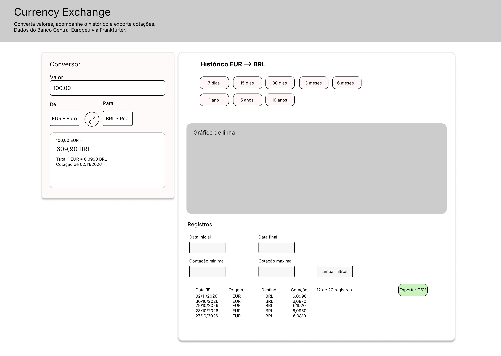
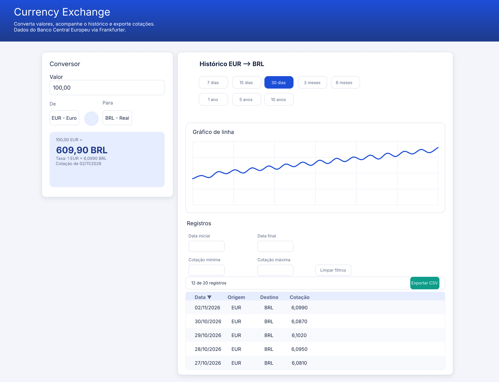
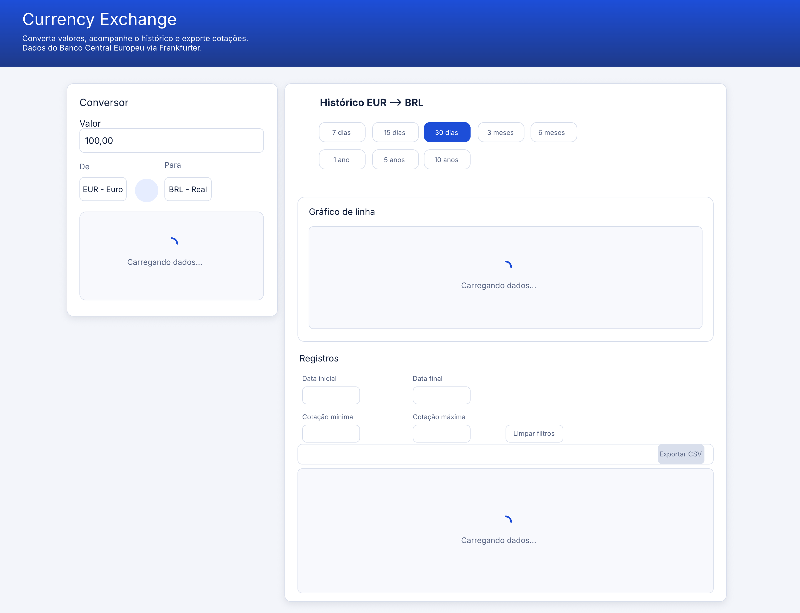
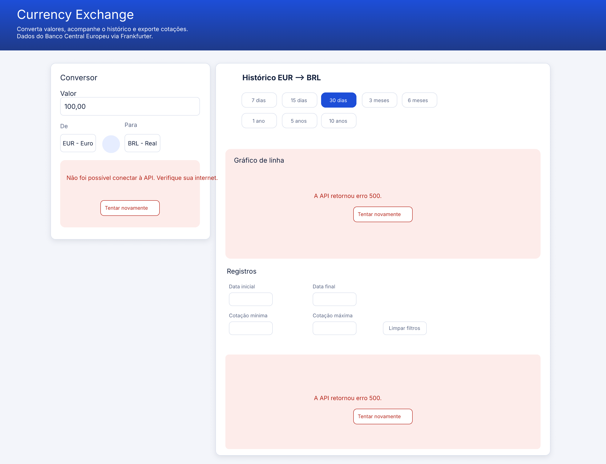
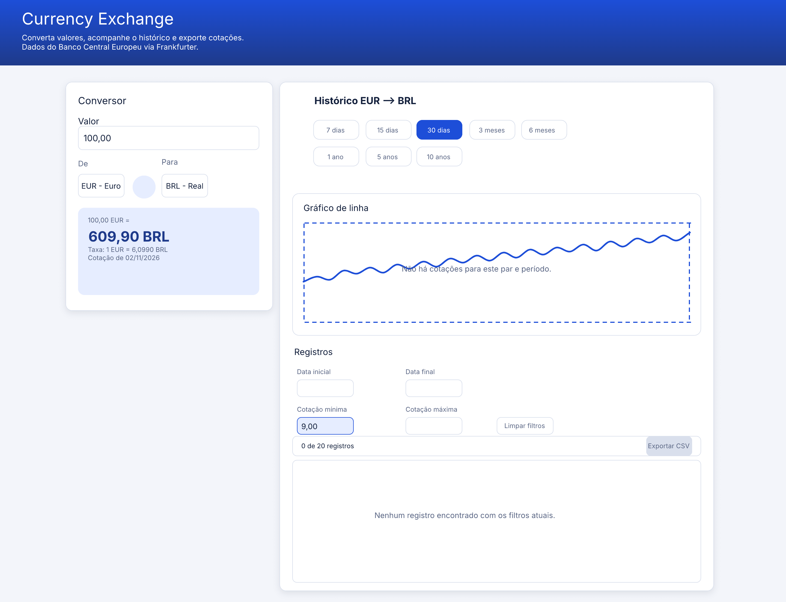

# Protótipos — pen.dev

Os protótipos foram feitos no **pen.dev** (extensão do VS Code), conforme orientação do professor, em vez do Figma.

- **Arquivo editável:** [`design/currency-exchange.pen`](../design/currency-exchange.pen). Para abrir é preciso a extensão pen.dev no VS Code.
- **Imagens exportadas:** `docs/images/` (abaixo).

## Processo

1. **Wireframe de baixa fidelidade (desktop):** desenhado por mim, manualmente, só com retângulos e textos, definindo a estrutura da tela.
2. **Protótipo de média fidelidade (desktop):** gerado pelo agente de IA do pen.dev a partir do wireframe, com cores, tipografia e dados de exemplo, e depois revisado e ajustado por mim: _(descreva o que você mudou)_.
3. **Estados (loading, erro, ausência de dados):** gerados pelo agente a partir do protótipo e revisados por mim.

> Observação: a aplicação foi desenvolvida antes deste protótipo, então o design documenta a interface implementada.

## Telas

| Tela | Imagem |
| --- | --- |
| Wireframe desktop |  |
| Protótipo desktop |  |
| Estado: loading |  |
| Estado: erro |  |
| Estado: ausência de dados |  |

## Pendente

- Wireframe e protótipo da versão **mobile** (adaptação para 360 px).

## Design guide usado

| Item | Valor |
| --- | --- |
| Cor primária | `#1D4ED8` (escura `#1E3A8A`, suave `#E6EDFF`) |
| Destaque (exportar) | `#0F9D8A` |
| Erro | `#B42318` sobre `#FDECEA` |
| Fundo / superfície | `#F3F5FA` / `#FFFFFF` |
| Texto / secundário | `#14213D` / `#5B6785` |
| Borda | `#D9DFEC` |
| Raio dos cartões | 12 px |
| Fonte | Inter |
| Largura máxima | 1100 px |
| Breakpoints | 900 px e 600 px |